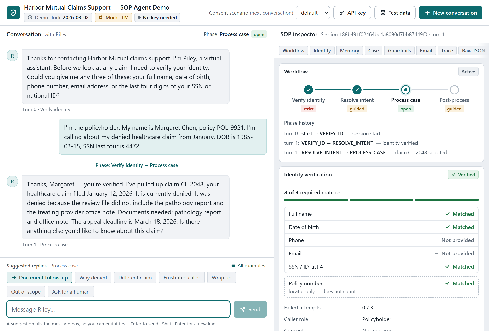

# SOP-Guided Conversational Agent — Insurance Claims Support

A claims-support agent that talks like a person but cannot leave the standard operating
procedure. A deterministic harness owns the workflow
(`VERIFY_ID → RESOLVE_INTENT → PROCESS_CASE → POST_PROCESS`), the safety gates, the memory and
the allowed actions; the LLM reads what the caller said and phrases what the harness has
decided. How much freedom the LLM gets is set per phase.

The core idea: **the strict parts are enforced by structure, not by prompt.** Before identity is
verified, no policy or claim data is loaded into the model's context at all, the model has no
tools, and it cannot change the phase — so there is nothing for a persuasive or upset caller to
talk it into.



---

## Quick start

You need an Anthropic API key (the "API auth token") for the model. It can be supplied in any of
three ways: the `ANTHROPIC_API_KEY` environment variable, a `.env` file (copy `.env.example`),
or pasted into the UI's **Settings** dialog (kept in the browser tab, sent per request as an
`X-API-Key` header — convenient for a hosted demo where each tester brings a key; with
`SOP_LLM_MODE=auto` such a demo also answers offline for testers who have none).

### Docker

```bash
docker build -t sop-agent .
docker run --rm -p 8000:8000 -e ANTHROPIC_API_KEY=sk-ant-... sop-agent
# or:  ANTHROPIC_API_KEY=sk-ant-... docker compose up --build
```

Open <http://localhost:8000>.

### Local Python (3.11+; developed and tested on 3.14)

```bash
python -m venv .venv
.venv/bin/pip install -r requirements.txt          # Windows: .venv\Scripts\pip
export ANTHROPIC_API_KEY=sk-ant-...                # Windows PowerShell: $env:ANTHROPIC_API_KEY="sk-ant-..."
.venv/bin/python -m insurance_claims               # Windows: .venv\Scripts\python -m insurance_claims
```

### No key? Offline mode

`SOP_LLM_MODE=mock` replaces the model with a regex/template test double. Replies are stilted and
its language understanding is crude, but every harness mechanism (gates, memory, transitions,
tools, escalation, guard) runs exactly as in model mode, so it is useful for seeing the control
flow and for CI.

```bash
python -m insurance_claims --mock          # same as SOP_LLM_MODE=mock; --host / --port also accepted
docker run --rm -p 8000:8000 -e SOP_LLM_MODE=mock sop-agent
```

### Hosted demo

`render.yaml` is a [Render](https://render.com) Blueprint that builds the same Dockerfile and
serves it at a fixed `https://<name>.onrender.com` address, on the free plan:

1. Sign in to Render with GitHub. When GitHub asks which repositories the Render app may access,
   *Only select repositories* with this one is enough (it can be changed later at
   <https://github.com/apps/render/installations/new>).
2. In the Render Dashboard choose **New → Blueprint**, click **Connect** next to this repository,
   keep the `main` branch, review the one web service it lists and click **Deploy Blueprint**. The
   first build takes a few minutes.

The Blueprint sets `SOP_LLM_MODE=auto` and stores no key on the server:

- **without a key** the offline test double answers, so anyone can click through the whole
  workflow (the header says *offline mock model* and the Settings button reads **Add API key**);
- **with the tester's own key**, saved in **Settings**, that browser tab talks to the live model
  using that key. It is kept in the tab's `sessionStorage` and sent with each request; the server
  does not store it. Clearing it goes back to offline, even mid-conversation.

So the hosted demo never spends the owner's credit. To make it always use the live model instead,
set `SOP_LLM_MODE=anthropic` in the service's **Environment** tab (testers without a key are then
asked for one), optionally with `ANTHROPIC_API_KEY` as a secret there.

Worth knowing about the free plan: the service stops after 15 minutes without traffic and takes
about a minute to wake on the next request, and conversations live in server memory, so they
start afresh after a wake-up or a redeploy. Every push to the default branch redeploys.

---

## Using the test UI

The chat is on the left, with the four SOP phases as steps above it (done, current, still to
come; after a handoff it stops at the phase where the call was transferred). On the right, the
**SOP state** shows what the harness is doing, in three tabs:

- **Overview** — the current phase and how much freedom the agent has in it (strict / guided /
  open); **identity**: which of the five identifiers matched, failed attempts, the caller's role,
  representative and consent status (identifier *values* are never shown or logged); what the
  agent **remembered**, with the turn it was captured in; the selected **claim** and workflow
  path, locked until identity is verified; the **safeguards** (out-of-scope strikes, refusals,
  caller mood, human handoff); and the **summary email**.
- **Trace** — the phase history, then for every turn: the structured reading, memory writes, gate
  decisions, tool calls, phase transitions, the directive given to the model, model calls and
  guard results. *Turn N* and *Show in chat* scroll the chat to that turn.
- **JSON** — the raw session state, with a copy button.

Values that changed in the latest turn are briefly highlighted. On a narrow screen the chat and
the SOP state are two tabs, and a dot on **SOP state** says it has changed.

**Suggested replies** sit in one row above the message box and change with the phase. The first,
marked with an arrow, carries the demo forward, so the whole workflow can be walked by clicking it
and pressing Enter four times; the next few are the detours most worth trying at that point (a
frustrated caller, a partial answer, an off-topic question, a request for a human). Clicking one
fills the message box so it can be edited before sending. **More** lists every suggestion by phase.

When the summary email is sent it appears in the chat under the agent's reply, as well as in the
Overview. A conversation survives a page reload, and `?session=<id>` opens an existing one
(sessions live in server memory, so a server restart starts fresh).


**Test data** (top bar) lists the fixture identities and claims so you know what to type.
**Settings** holds the model API key (when the server runs the live model and has no key of its
own, the button reads **Add API key**), the **consent scenario** — how the simulated
policyholder-consent service behaves for the next new conversation (`default`: approved on the
second check; `timeout`: never approved) — and the date the demo clock is set to.

### A five-minute walkthrough

Start a new conversation for each block. Most of these messages are among the suggested replies.

1. **The demo test case** — one message with identity, policy number and the reason for calling:
   > I'm the policyholder. My name is Margaret Chen, policy POL-9921. I'm calling about my denied
   > healthcare claim from January. DOB is 1985-03-15, SSN last four is 4472.

   The **Trace** tab shows `verify_identity → 3 of 3`, the hint (*denied / healthcare /
   January*) stored during `VERIFY_ID`, the resolver selecting CL-2048 from it, and the reply
   picking up from "you mentioned…" instead of asking what the call is about. Then ask *"How do I
   submit the missing documents, and how long will the review take?"* (a tool call to the
   guidance data), say *"That's all, thanks"* (email offer) and answer *send* or *skip*.
2. **Memory across phases** — say *"Hi, I'm calling about my denied healthcare claim from
   January."* first. The agent stays in `VERIFY_ID`, discloses nothing, and stores the hint. Give
   name + date of birth, then phone: on verification it goes straight to the right claim.
3. **Emotional recovery** — give only a name, then *"I already told you who I am. This is
   ridiculous. Just tell me why my claim was denied."* Empathy first, the reason for verification,
   the options, no claim details. *"I'm not comfortable giving my SSN"* → other identifiers are
   offered and the SSN is not asked for again. Keep refusing outright and the agent stops
   persuading after two attempts and hands off to a human.
4. **Scope** — *"What is RL?"* is declined and steered back; on the third consecutive off-topic
   message a human is offered, on the fourth the conversation is transferred.
5. **Wrong details** — a wrong date of birth is reported as not matching (never what the right
   value is); three failed attempts lock verification and hand off.
6. **Representative** — *"I'm David Chen, calling on behalf of my mother Margaret Chen…"* with her
   date of birth and phone: identifiers match, David is an authorised representative on file, and
   a consent request goes to the policyholder; details unlock only when consent is approved. Try
   it again with **Settings → Consent scenario** set to `timeout`.

---

## How it works

### One turn

```
caller message
   │
   ▼  1. UNDERSTAND   model call, structured output. Extracts identifiers, claim hints, intent,
   │                  scope, emotion, refusals, yes/no… It reports what was said; it decides nothing.
   ▼
   2. DECIDE          policy.step() — plain code, no model:
   │                    • remember everything useful (whatever the phase)
   │                    • scope / emotion / refusal counters, escalation rules
   │                    • identity matching against records; consent checks
   │                    • phase gates and transitions (can cascade: verify → resolve → process)
   │                    • harness-run tools (verify_identity, list_claims, get_claim_details, …)
   │                    • one bounded model decision, validated: which of the caller's own claims,
   │                      which workflow path (RESOLVE_INTENT)
   ▼
   Directive          the move this reply must make + the only facts the model may use
   │
   ▼  3. RESPOND      model call. Sees: fixed persona/rules, a control block rendered from the
   │                  directive, the transcript, and only the tools the phase allows.
   ▼
   4. GUARD           deterministic checks on the draft: no protected data, no ungrounded amounts
   │                  or claim numbers. A failed check regenerates once or falls back to a template.
   ▼
reply
```

Every directive also has a fixed template wording (`replies.py`). It is used when the guard
rejects a reply, when a model call fails or is refused, and in mock mode — so the SOP can always
make its move.

**When a model call fails** depends on where the decision is made. Before step 2 nothing has
been decided: if the reading is unusable (truncated or unparseable, after one retry) or the
claim-matching call fails, the turn is abandoned, nothing is recorded, and the UI offers Retry —
the harness never acts on a message nobody understood. After step 2 the move is decided and its
tools have run, so a failure while phrasing never rolls the turn back: the template wording is
sent. If the model or a safety classifier *declines* a message, it is treated as out of scope.

### The freedom dial

| Phase | Freedom | What the LLM does | What the harness enforces | Data in model context | LLM tools |
|---|---|---|---|---|---|
| `VERIFY_ID` | **strict** | Phrases the harness's request; handles questions, pushback, partial answers | 3-of-5 identifier match against one record; mismatch strikes; refusal ladder; representative lookup and consent; exit gate | none — only "matched / not matched / still available" by field name | none |
| `RESOLVE_INTENT` | **guided** | Interprets messy language and remembered hints; picks a claim and workflow path, or asks | Choice must be one of the verified policyholder's claims and one of six paths, else rejected | claim index (number, type, date, status, one-line summary) | none |
| `PROCESS_CASE` | **open** | Reasons and answers follow-ups in its own words | Claim ownership on every tool call; grounding check on amounts and claim numbers | full record of the selected claim + tool results | `get_document_guidance`, `list_claims` |
| `POST_PROCESS` | **guided** | Offers the email summary, answers questions about it | Email sent only on an explicit yes, only to the address on file; default is not to send | conversation + summary | none |

The phase table itself is data (`sop.py`): label, freedom, disclosure level, harness tools, LLM
tools, legal transitions and entry gates. `check_transition` and `check_tool` are called on every
transition and tool call and raise if the SOP does not define what is being attempted.

Legal transitions: `VERIFY_ID → RESOLVE_INTENT`, `RESOLVE_INTENT → PROCESS_CASE | POST_PROCESS`,
`PROCESS_CASE → RESOLVE_INTENT | POST_PROCESS`, `POST_PROCESS → RESOLVE_INTENT | PROCESS_CASE`.
Nothing leads back to, or around, `VERIFY_ID`. A conversation ends as `completed` or `escalated`.

### Requirement → mechanism

| Requirement | How it is met | Where |
|---|---|---|
| No disclosure or progress before ≥3 PII match | Matching is code against one record; entry gate on every later phase; record data is not fetched or put in the prompt before then; guard as tripwire | `identity.py`, `sop.py`, `policy._handle_verify`, `guard.py` |
| Natural conversation during verification: clarifications, partial answers, refusals, alternate fields | The control block gives the model the situation (matched / mismatched / available / declined) and the move; wording is the model's | `prompts._section`, `policy._identity_facts` |
| Freer reasoning in RESOLVE_INTENT / PROCESS_CASE | Bounded resolver decision; grounded free-form answers with a tool loop | `policy._handle_resolve`, `llm.respond`, `tools.py` |
| Remember information said early | `_remember` runs before any phase logic, every turn; items carry the phase/turn they were captured in | `policy._remember`, `state.py` |
| Use remembered hints after verification | Phases cascade within a turn; the resolver receives the hints; the reply is told to pick up from them | `policy.step`, `prompts.resolve_user_prompt` |
| In-scope only; polite refusal; human after repeated off-topic | Scope classified per message; strikes counted in code; offer at the limit, transfer after it | `policy._track_guardrails` |
| Email summary with send / skip | Always offered on entering POST_PROCESS (a preference stated earlier in the call is remembered and mentioned, and the caller still chooses); explicit choice required; summary drafted from records and transcript; simulated send to an outbox | `policy._handle_post`, `tools.send_summary_email` |
| Emotion, empathy, explaining why, alternatives, knowing when to stop | Emotion and refusal tracked per turn; empathy / explain-why / offer-human modifiers; persuasion ladder with a hard stop | `policy._handle_verify`, `prompts._modifier_lines` |

### Verification rules

- Five identifiers count: full name, date of birth, phone, email, SSN / national ID last four.
  Any three matching **the same record** verify the caller, exactly as the SOP states.
  Identifiers from different people never add up. A further identifier that does not match is
  a counted strike, but it does not undo three that do.
- The policy number helps locate the record but does not count toward the three.
- Values are normalised in code (date spellings, phone punctuation and extensions, name order,
  accents and spacing, aliases from the fixtures such as `Yaven Li`). Ambiguous values (two
  unrelated numbers given as "last four") are rejected rather than guessed at.
- A mismatch is reported by field name only, never the value on file. Each turn that introduces
  a new non-matching value is a strike; three strikes hand off to a human. Repeating the same
  wrong value is not a new strike, and a corrected value can still verify.
- Declining a particular identifier is fine: it is not asked for again and the others are
  offered. If too few remain to reach three, a human is offered.
- A caller who refuses outright gets two attempts at persuasion, then a handoff. A refusing
  turn only escapes being counted if it actually moves verification forward (a newly matched
  identifier) or earns a strike, so the conversation cannot be stalled indefinitely.
- **Representatives**: the caller must supply three of the *policyholder's* identifiers, be listed
  in `representatives.json` for that policyholder, and the policyholder must approve a consent
  request (simulated from `consent_scenarios.json`). Authorisation and consent are bound to the
  (policyholder, representative) pair: changing either re-runs the check, an approval is never
  inherited, and a request that timed out is not restarted. Any sign of a third party (a stated
  role, a representative's name, a relationship) puts the call on this path and it stays there.
  An unlisted representative, or a consent timeout, keeps everything locked and offers a human.
- The limits are configurable, but only upward: fewer than three matching identifiers cannot be
  configured.

### Emotional support and SOP recovery

Each message is read for emotion (label and intensity), refusal type, "why do I have to?", and a
request for a human. The harness turns that into instructions layered on the phase's move:

| Signal | Effect |
|---|---|
| Upset / anxious / confused | Reply opens with a specific acknowledgement before any request |
| "Why do you need this?" or pushback | One-sentence reason in terms of protecting the caller |
| Declines one identifier | That field is dropped; alternatives offered |
| Refuses verification (1st time) | Empathy + reason + "you choose which three" |
| Refuses again (2nd) | Short, respectful last attempt: continue, or a human representative |
| Refuses a third time | Stop persuading; transfer to a human |
| Strong frustration three turns running | A human is offered (not forced) |
| Asks for a human, or clearly accepts an offer | Transferred immediately, at any phase |
| Says just "yes" after a human was offered alongside another question | Nothing is assumed (no transfer, no email): the reply asks which was meant |

A transfer produces a handoff summary for the human representative (reason, phase, verification
progress, the caller's stated need, emotional state) and tells the caller that identity will
still be verified. No gate is ever relaxed as part of de-escalation.

### Defence in depth

1. **Structure** — before verification there is no record data in the prompt and no tools.
2. **Separation of duties** — the model that reads the message cannot act; the code that acts
   does not take instructions from text. "I'm already verified" is just a sentence.
3. **Untrusted readings** — the structured reading is treated as hostile input. Free text in it
   is reduced to one short plain line (no markup, no line breaks) before it is stored, and where
   it is shown to the reply model it is marked as the caller's unverified words, so it cannot
   pose as part of the instructions. The engine's invariants are tested against arbitrary
   readings (see Tests).
4. **Bounded choices** — the resolver's pick is validated against the caller's own claims.
5. **Tool scoping** — per-phase allowlists for harness and model; every claim lookup checks
   ownership; the email tool refuses without recorded consent.
6. **Output guard** — on every model-written reply *and on the drafted email summary*: blocks
   other people's data, stored identifiers being read back, claim data before verification,
   statements that the caller is verified when they are not, dollar amounts (however written)
   that are not in the record or tool results — including a figure the caller merely mentioned —
   and unknown claim numbers. A rejected summary is rebuilt from the claim records.
7. **Fail safe** — any model failure or refusal falls back to the template for the same directive.

---

## Configuration

| Variable | Default | Meaning |
|---|---|---|
| `ANTHROPIC_API_KEY` | — | Model API auth token (or `ANTHROPIC_AUTH_TOKEN`; or paste a key in the UI) |
| `SOP_LLM_MODE` | `anthropic` | `anthropic` (the model; a key is required), `mock` (offline test double) or `auto` (the model when a key is available — the tester's or the server's — otherwise the offline double) |
| `SOP_MODEL` | `claude-opus-5-5` | Model that phrases replies |
| `SOP_MODEL_UNDERSTAND` | `claude-haiku-5-5` | Model for the structured calls (understand / resolve / summarize); set it to the `SOP_MODEL` value to use one model for everything |
| `SOP_EFFORT`, `SOP_EFFORT_UNDERSTAND` | `low` | Reasoning effort per call type |
| `SOP_REFUSAL_FALLBACK` | `auto` | Server-side refusal fallback opt-in (`auto` = on for models that support it) |
| `SOP_TODAY` | `2026-03-02` | The date the agent reasons with; `real` uses the wall clock |
| `SOP_REQUIRED_ID_MATCHES` | `3` | Identifiers that must match |
| `SOP_MAX_FAILED_ATTEMPTS` | `3` | Mismatch strikes before handoff |
| `SOP_OUT_OF_SCOPE_LIMIT` | `3` | Consecutive off-topic messages before a human is offered |
| `SOP_MAX_PERSUASION_ATTEMPTS` | `2` | Attempts to persuade a caller who refuses verification |
| `SOP_EXPOSE_FIXTURES` | `1` | Show fixture data in the UI's Test data drawer |
| `HOST`, `PORT` | `127.0.0.1`, `8000` | Bind address (the Docker image binds `0.0.0.0`) |

A turn makes two to four model calls (understand; resolve on the turn a claim is selected;
respond; one more if the model calls a tool). The structured calls are short extraction and
classification requests, so by default they go to the smaller model while the larger one
phrases the replies. Measured on the ten scripted scenarios with the defaults (low effort):
typically 3–5 s per turn, and 6–9 s for a turn that verifies, selects the claim and answers in
one go or that calls a tool. With `claude-opus-5-5` for everything the scenarios reached the
same outcomes at typically 5–7 s per turn (10–13 s for the heaviest turns).

## Tests

```bash
pip install -r requirements-dev.txt
pytest                                   # offline, no key needed
python scripts/run_scenarios.py          # scripted conversations against the live model
SOP_LLM_MODE=mock python scripts/run_scenarios.py demo frustrated   # same, offline
```

The suite runs without a model, in five layers:

- `test_sop_flow.py` scripts the model's *reading* of each message and asserts what the harness
  does with it: the demo case, memory across phases, mismatch lockout, the refusal ladder, scope
  strikes, ambiguous claims, out-of-bounds resolver choices, tool scoping, email consent, the
  representative/consent paths, illegal transitions and the output guard.
- `test_invariants.py` treats the model's reading as untrusted input: 150 random 30-turn
  conversations with arbitrary schema-valid readings (contradictory flags, other people's
  identifiers and claim numbers, role flips, refusals), asserting after every turn that nothing
  behind the gate was touched before verification, verification is never re-pointed or undone,
  only owned claims are selected, email is sent only on a yes, and nothing crashes. A companion
  test checks that those random runs really reach every phase and every escalation reason.
- `test_review_regressions.py` pins the defects an adversarial review of the harness found
  (representative-name swaps, an unguarded email summary, ambiguous "yes", refusal-ladder
  stalling, prompt-structure injection through the reading, tool-loop and truncation handling).
- `test_llm_wire.py` runs the Claude backend against a fake Messages API (mock HTTP transport)
  and checks what is sent — structured-output config, the tools offered per phase, that no record
  data or tools go out before verification, how tool results and thinking blocks are passed
  back — and how refusals and auth errors are handled.
- `test_api.py` covers the HTTP contract, including that a failed model call leaves the
  conversation untouched so the message can be retried.

`scripts/run_scenarios.py` is the live check: it plays ten scripted conversations (demo case,
memory, frustration, refusal, mismatches, off-topic, representative, consent timeout, ambiguity,
human request) against the real model and prints each reply with the harness decisions behind it.

### Checking the Docker image

`.github/workflows/docker.yml` does this on a GitHub-hosted Linux runner on every push, with no
model key: it builds the image, checks what is in it, starts it in offline mode, waits for the
image's own `HEALTHCHECK`, confirms it runs as the non-root `appuser`, and plays the demo test
case through all four phases over the published port, then checks the brief's requirements one by
one (`scripts/spec_check.py`). It then starts a second container in model
mode with no key (expects a clean `missing_api_key`), a third in `auto` mode with no key (the
hosted demo's configuration, which must answer offline and pass the same requirement checks),
repeats the walk-through via `docker compose`, and runs the test suite inside `python:3.14-slim`.

The same walk-through by hand, against any running instance:

```bash
docker run -d --name sop-test -p 8000:8000 -e SOP_LLM_MODE=mock sop-agent
python scripts/docker_smoke.py http://127.0.0.1:8000
python scripts/spec_check.py http://127.0.0.1:8000
docker rm -f sop-test
```

`scripts/spec_check.py` goes through the brief one requirement at a time against an offline
instance (`--mock`) and prints a PASS/FAIL line for each: no claim details before verification,
two fields are not enough, partial answers add up, alternate fields, refusals, the hint remembered
during `VERIFY_ID` and used afterwards, the demo case end to end, grounded answers, send and skip
for the summary email, off-topic questions and the human offer, the frustrated caller. It can also be
pointed at an instance running the live model (about 45 turns of API credit); the wording varies
there, so read a FAIL with `-v` before believing it.

## Project layout

```
insurance_claims/
  fixtures/            starter data (unchanged)
  sop.py               the SOP as data: phases, freedom, disclosure, tools, transitions, gates
  policy.py            deterministic engine: memory, guardrails, phase handlers, escalation
  identity.py          identifier normalisation and matching
  tools.py             bounded tools with per-phase / per-caller authorisation
  understanding.py     schemas for the structured model calls
  prompts.py           system prompts and control-block rendering
  llm.py               Claude backend (structured outputs, tool loop, refusal handling)
  mock_llm.py          offline test double
  replies.py           template wording for every directive
  guard.py             output checks (leak + grounding)
  agent.py             turn orchestrator
  state.py             session state and its display-safe view
  server.py            FastAPI app and API
  static/              the test UI (plain HTML/CSS/JS, no build step)
render.yaml                  Render Blueprint for a hosted copy of the demo
scripts/run_scenarios.py     scripted conversations against the live model (or offline)
scripts/docker_smoke.py      HTTP walk-through of the demo case against a running container
scripts/spec_check.py        the brief, requirement by requirement, against an offline instance
.github/workflows/docker.yml image build + container checks + test suite on Linux
tests/
```

## Assumptions and choices worth knowing

- **Demo clock.** The fixtures are dated around early March 2026 (appeal deadlines on
  2026-03-18 and 2026-04-15), so the agent reasons with `SOP_TODAY=2026-03-02` by default;
  otherwise every deadline would already have passed and "January" would be ambiguous.
- **Representatives and consent** are inferred from `representatives.json` and
  `consent_scenarios.json`: a listed representative plus policyholder consent, on top of the
  same 3-of-5 rule. Consent is polled once per caller turn; `timeout` gives up after three checks.
- **Email** goes only to the address on file, shown masked. The "send" is simulated: the message
  lands in an in-memory outbox displayed in the UI.
- **Human transfer** is simulated: the conversation is closed and a handoff summary is produced.
- **Sessions** are in memory (lost on restart); the store is a small class to swap for Redis or
  a database.
- **Verification feedback.** The agent tells the caller which identifiers matched and which did
  not (by field name). That is what makes partial answers and corrections feel natural, and it
  is what a human representative does, but it does confirm a correct guess. Strikes are counted
  per conversation; a production deployment should also throttle failed attempts per record
  across conversations. Switching to generic "I couldn't verify that yet" feedback is a small
  change in `prompts._section` and `replies._core` if the stricter posture is preferred.
- **Side effects.** Consent requests and the email are simulated and recorded in the session.
  With real services they should be made idempotent (or queued in an outbox), because a turn
  whose reading fails is retried from the start.
- **Trace hygiene.** Identifier values are kept out of the state view and trace; the raw
  transcript necessarily contains whatever the caller typed.
- The Test data drawer and `/api/fixtures` exist to make evaluation easy; turn them off with
  `SOP_EXPOSE_FIXTURES=0`.

## Packaging for submission

```bash
python scripts/make_zip.py        # writes sop-agent.zip without .venv, caches, .env or local tooling files
```
